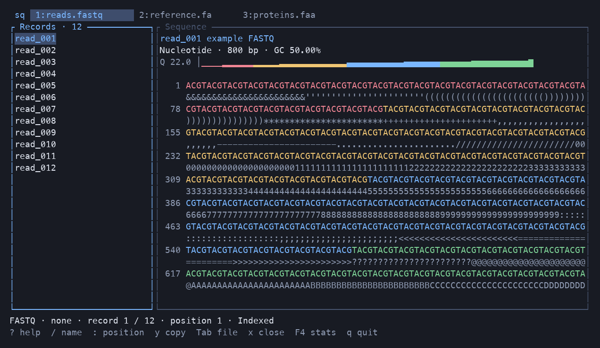

# seqviz-rs

[English](README.md) | [简体中文](README.zh-CN.md)

**See sequences and read quality in your terminal.**

`sq` is a biological sequence browser. Give it a file path to browse records and sequences side by side, or open several files in separate tabs. It supports nucleotide and protein FASTA, FASTQ, and SAM/BAM on macOS and Linux. The interface is in English.

```sh
sq genome.fa
sq reads.fastq.gz
sq proteins.faa alignments.bam
```

You can also open files from yazi with Enter, then press `q` to return to the file list.



## What you can see

| File | Display |
| --- | --- |
| Nucleotide FASTA | Coloured bases, full header, length and GC |
| Protein FASTA | Residue-category colours, full header and sequence length |
| FASTQ | Bases coloured by quality, an aligned quality character row, a quality overview and metrics such as Q30 |
| SAM / BAM | Sequence and quality for each alignment, plus reference, position, FLAG, MAPQ, CIGAR and optional fields |

gzip and BGZF input are supported. FASTQ accepts wrapped sequence and quality fields, uses Phred+33, and parses headers from Illumina, Nanopore, PacBio and SRA. The original header is always retained.

Sequences wrap to the window width, with positions starting at 1. Each file keeps its current record and scroll position while you switch tabs. In FASTA/FASTQ, drag across lines to select sequence and hold the pointer at an edge to keep scrolling. Resizing preserves the selected sequence coordinates.

## Install and try it

You need Rust, Cargo and a C compiler. Install `sq` from the source checkout:

```sh
git clone https://github.com/Georicl/seqviz-rs.git
cd seqviz-rs
cargo install --path . --locked
sq --version
sq test/test.fa
```

To try the bundled examples without installing the command:

```sh
cargo run --release --locked -- test/test.fa test/alignments.bam
```

Pass multiple paths to browse files in the same window. Use `--` before a path whose name begins with `-`.

```sh
sq assembly.fa reads.fastq.gz proteins.faa
sq -- "-sample.fa"
```

## Common controls

| Action | Key or mouse |
| --- | --- |
| Move through records or sequence rows | ↑ / ↓, or `j` / `k` |
| Move the sequence cursor horizontally | ← / →, or `h` / `l` |
| Previous / next record | `[` / `]` |
| Focus the record list / sequence pane | Click the pane, or `Ctrl+h` / `Ctrl+l` |
| Page, or jump to the beginning / end | Page Up / Page Down, Home / End |
| Search names by partial match | `/`, type a name, then Enter; `n` finds the next match |
| Jump within the current sequence | `:`, type a 1-based position, then Enter |
| Next / previous file tab | Tab / Shift+Tab |
| Close the current file tab | `x` |
| Select and copy sequence | Drag, or press `v` and move the cursor; `y` copies |
| Show / hide the quality character row | `Q` |
| Help / file / current record / statistics | `?` or F1 / F2 / F3 / F4 |
| Cancel work and pause background indexing | Esc in the browser |
| Leave an information page / quit the browser | `q` |

The mouse wheel scrolls the pane under the pointer. In an information page, use Tab or Left / Right to switch pages. Press `?` for the full controls.

The `F4` statistics page shows record count, total length, minimum/maximum/mean length and N50 where applicable. GC is displayed to two decimal places. Statistics run on demand in the background, with status shown while scanning is incomplete. SAM/BAM statistics count each alignment without deduplication and do not show N50.

## Open from yazi

After installation, make sure yazi can find `sq` on PATH, then merge the matching example into `~/.config/yazi/yazi.toml`.

| yazi version | Configuration example |
| --- | --- |
| 25.4 | [contrib/yazi.toml](contrib/yazi.toml) |
| 26.9 | [contrib/yazi-26.toml](contrib/yazi-26.toml) |

The opener uses `block = true`. Press Enter on a file to open `sq` in the same terminal; quitting returns you to yazi.

## Copy sequences

In FASTA/FASTQ, `y` copies from the focused pane.

| Location | Clipboard content |
| --- | --- |
| FASTA record list | Full header and complete sequence, wrapped at 60 characters |
| FASTQ record list | Complete FASTQ record, preserving the original header and separator line |
| Sequence selection | Continuous sequence, without display line breaks, position numbers or quality characters |
| Information page | Selected text, or the current page if nothing is selected |

**All copying is disabled for SAM/BAM, including information pages.**

Local copying prefers the system clipboard: `pbcopy` on macOS, or `wl-copy`, `xclip` or `xsel` on Linux. Over SSH, it sends an OSC 52 request to the local terminal, which must support this feature. Copying a complete record reads and temporarily holds its full contents.

## Large files and caches

`sq` reads the first screen, then builds the index in chunks. The record list and sequence content are loaded for the current window, so browsing does not load the whole file into memory. Indexes and compression checkpoints are saved for reuse; changes to the source invalidate the old index. Reaching a distant, unindexed position for the first time still requires scanning or decompression.

Caches live in `$XDG_CACHE_HOME/seqviz-rs/`, defaulting to `~/.cache/seqviz-rs/`. They persist after exit and are not cleaned automatically. You can delete them after closing all `sq` instances; they will be rebuilt when needed. Ordinary gzip uses decompression checkpoints without creating a full uncompressed copy.

Source files remain read-only. Redirecting FASTA output to a file or pipe produces text; other formats require an interactive terminal.

## Colours

The default theme works without configuration. To change it, place [config/config.toml](config/config.toml) and [config/content.toml](config/content.toml) in `~/.config/seqviz-rs/`. If `XDG_CONFIG_HOME` is set to an absolute path, use its `seqviz-rs/` directory instead.

`config.toml` sets interface colours such as the background and borders. It references `content.toml` for nucleotide, amino acid and quality colours.
