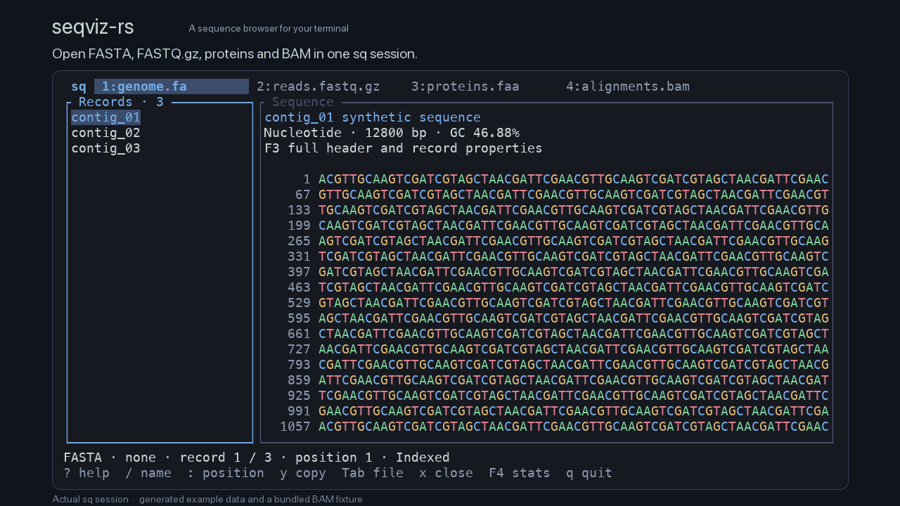

<p align="center">
  
</p>

# seqviz-rs

[English](README.md) | [简体中文](README.zh-CN.md)

**Browse sequences, inspect read quality and variants, and edit FASTA and FASTQ records in your terminal.**

Open FASTA, FASTQ, SAM/BAM and VCF files in separate tabs with `sq`, including gzip and BGZF inputs. Available for macOS and Linux with an English interface.

```sh
sq genome.fa
sq reads.fastq.gz
sq genome.fa variants.vcf.gz
```

[](assets/demo.gif)

## New in v2.2.1

- **Compare genotypes across samples.** Press uppercase `M` in a VCF to open a matrix with one variant per row and one sample per column. Select a cell and press Enter to inspect its FORMAT fields.
- **Inspect alternate allele frequencies.** Press `4` to compare the file's `INFO/AF` with frequencies calculated from sample genotypes. Press F4 for frequency distributions across the current record filter.
- **Edit FASTA and FASTQ records.** Press `i` to type, paste or replace a selection. In FASTQ, use Tab to enter quality characters for inserted or replaced bases. Press Ctrl+S to save to the original file.

## Supported files

| File | Main content | Mode |
| --- | --- | --- |
| Nucleotide FASTA | Coloured bases, full header, length and GC | Browse and edit |
| Protein FASTA | Residue-category colours, full header and length | Browse and edit |
| FASTQ | Phred+33 quality colours, aligned quality characters, quality overview and metrics such as Q30 | Browse and edit |
| SAM / BAM | Alignment sequence, quality, reference coordinates, FLAG, MAPQ, CIGAR and optional fields | Read-only |
| Ordinary VCF 4.0–4.5 | Variant table, genotype matrix, contig/coordinate navigation, INFO, Samples, Raw, AF and original header | Read-only |

gzip and BGZF are supported for these inputs. FASTQ accepts wrapped sequence and quality fields and parses Illumina, Nanopore, PacBio and SRA headers while retaining original headers.

## Install

### Homebrew

Available for Apple Silicon macOS, Intel macOS and x86_64 Linux. The command is `sq`.

```sh
brew install Georicl/tap/seqviz-rs
sq --version
```

To upgrade to v2.2.1:

```sh
brew upgrade Georicl/tap/seqviz-rs
```

Theme and yazi examples are under `$(brew --prefix seqviz-rs)/share/seqviz-rs/`, in `config/` and `contrib/`.

### Download a binary

Download from the [latest release](https://github.com/Georicl/seqviz-rs/releases/latest). Rust is not required.

| Platform | Archive |
| --- | --- |
| macOS 11+ · Apple Silicon | [aarch64-apple-darwin](https://github.com/Georicl/seqviz-rs/releases/latest/download/seqviz-rs-aarch64-apple-darwin.tar.gz) |
| macOS 11+ · Intel | [x86_64-apple-darwin](https://github.com/Georicl/seqviz-rs/releases/latest/download/seqviz-rs-x86_64-apple-darwin.tar.gz) |
| Linux · x86_64 | [x86_64-unknown-linux-musl](https://github.com/Georicl/seqviz-rs/releases/latest/download/seqviz-rs-x86_64-unknown-linux-musl.tar.gz) |

Extract the archive, then run these commands in the extracted directory:

```sh
mkdir -p "$HOME/.local/bin"
install -m 755 sq "$HOME/.local/bin/sq"
export PATH="$HOME/.local/bin:$PATH"
sq --version
```

Add `~/.local/bin` to your shell's PATH to use `sq` in new terminals. Archives include theme and yazi examples. Releases also provide [SHA-256 checksums](https://github.com/Georicl/seqviz-rs/releases/latest/download/SHA256SUMS).

### Build from source

Requires Rust stable, Cargo and a C compiler.

```sh
git clone https://github.com/Georicl/seqviz-rs.git
cd seqviz-rs
cargo install --path . --locked
sq --version
```

Or run the bundled examples directly:

```sh
cargo run --release --locked -- test/test.fa test/alignments.bam test/variants.vcf
```

## Controls

| Global action | Key |
| --- | --- |
| Next / previous file | Tab / Shift+Tab, or click a tab |
| Close current file | `x` |
| Help / file information | `?` or F1 / F2 |
| Close information panel / quit browser | `q` |

The mouse wheel scrolls the area under the pointer. For filenames starting with `-`, use `sq -- "-sample.fa"`.

### Sequence browsing

| Action | Key or mouse |
| --- | --- |
| Move through records or sequence | Arrow keys, or `j` / `k` / `h` / `l` |
| Previous / next record | `[` / `]` |
| Focus record list / sequence | Click the area, or Ctrl+h / Ctrl+l |
| Page / beginning / end | Page Up / Page Down / Home / End |
| Search by name / next match | `/`, then Enter / `n` |
| Filter records / cycle ordering | `f`, then conditions and Enter / `s` |
| Jump to a sequence position | `:`, then a 1-based coordinate and Enter |
| Select and copy sequence | Drag, or press `v` and move, then `y` to copy |
| Show / hide quality characters | `Q` |
| Edit current indexed FASTA/FASTQ record | `i` |
| Current record / statistics | F3 / F4 |
| Cancel work and pause indexing | Esc in the browsing view |

Sequences wrap to the window width. In FASTA/FASTQ, drag across lines and hold at an edge to keep scrolling, and resizing preserves the selected sequence coordinates. F4 shows record count, total length, minimum/maximum/mean length and N50 where applicable. SAM/BAM counts alignment records.

Use space-separated conditions with `f`, for example `name=read minlen=100 maxlen=1000`. Supported keys are `name`, `minlen`, `maxlen`, `mingc`, `maxgc`, `minq` and `maxq`. SAM/BAM also accepts a minimum `mapq`, required `flag` bits and excluded `noflag` bits, such as `mapq=30 noflag=0x104`. GC bounds are percentages, and quality bounds use each record's mean Phred score. Conditions are combined with AND. Submit empty input to clear the filter, or press Esc to cancel the filter prompt.

Press `s` to cycle source order, ascending name, descending length, GC and mean quality, with descending MAPQ also available for SAM/BAM. Missing values sort last. Name searches follow the active filter and ordering, and the selected source record stays selected as indexing advances.

Sequence F4 statistics cover completed records across the whole indexed file: length, GC and mean-quality distributions, score-weighted mean Phred and Q30, and SAM/BAM mapped, unmapped, primary, secondary, supplementary and duplicate counts. Filtering the list does not change this file-wide scope. An unfinished index is identified in the statistics status.

### Editing FASTA and FASTQ

| Action | Key |
| --- | --- |
| Open editor on current indexed record (including selection) | `i` |
| Move cursor / extend selection | Arrow keys / Shift+Arrow keys |
| Paste sequence or quality text | Terminal paste shortcut (typically ⌘V on macOS) |
| Delete bases (and paired FASTQ qualities) | Backspace / Delete |
| Switch between sequence and FASTQ quality track | `Tab` |
| Save back to source file and refresh index | `Ctrl+S` |
| Return to browsing / discard dirty draft | `Esc` / press `Esc` twice |

Move to a sequence position or select a range in an indexed FASTA or FASTQ record, then press `i` to edit the current record. Type directly or use the terminal paste shortcut. Multiline sequence pastes ignore whitespace and replace any active selection.

In FASTQ, the second row displays printable Phred+33 quality characters. Deleting bases removes their paired qualities. Missing quality characters under newly inserted or replaced bases appear as a dot (`·`) until you explicitly enter their printable Phred+33 quality characters. Press `Tab` to jump to the quality track at the first missing score, type or paste the quality characters, then press `Tab` to return to bases.

Press `Ctrl+S` to write changes back to the original file and refresh its index. Plain text, gzip and BGZF files preserve their original compression format. If the source file changed on disk since loading, overwrite is blocked. Press `Esc` to leave the editor, or press `Esc` twice to discard a dirty draft. VCF and SAM/BAM remain read-only.

### VCF browsing

The variant table shows CHROM, POS, ID, REF, ALT, TYPE, QUAL and FILTER. Narrow windows prioritise CHROM, POS, REF and ALT. A record with different ALT variant types is labelled MIXED.

| Action | Key |
| --- | --- |
| Move through variants or detail rows | ↑ / ↓ or `j` / `k`, Page Up / Page Down |
| Focus details or inspect matrix cell / return | Enter / Esc |
| Toggle variant table / genotype matrix | `M` |
| INFO / Samples / Raw / AF | `1` / `2` / `3` / `4`, or `[` / `]` |
| Toggle GT cohort between all and pinned samples | `a` in AF details or F4 statistics |
| Scroll details horizontally | ← / →, or `h` / `l` |
| Choose a contig | `c`, type to filter, then Enter (All records is also available) |
| Locate a position in the current contig | `:`, then a 1-based coordinate and Enter |
| Filter variants / cycle ordering | `f`, then conditions and Enter / `s` |
| Statistics for the active filter / refresh | F4 |
| Find sample name / next match | `/`, then Enter / `n` |
| Pin current sample / toggle pinned-sample display | `p` in Samples or the matrix / `P` |
| Choose FORMAT fields | `F`, for example `GT,DP,AD` |
| Original header | `m` or F3 |
| Copy current context | `y` |
| Copy header and current record from table or Raw | `Y` |

Press uppercase `M` in a VCF tab to toggle the genotype matrix. Rows are variant records and columns are samples. Use arrow keys to select a cell, press Enter to inspect that cell's FORMAT values, and press Esc to return to the cell. Source GT values and phase are preserved, including dots in partially or fully missing genotypes. A dash (`—`) indicates that a record has no GT field. The matrix follows the active filter, sort order and pinned-sample display.

Press `4` to view per-ALT `INFO/AF` from the file alongside GT-derived `AC`, `AN` and `AF`. `AN` counts all known reference and alternate copies, so known copies in partially missing genotypes contribute to the counts. A zero denominator displays as `.`. F4 shows both frequency distributions for the active record filter, counting each ALT separately. GT-derived frequencies use all samples by default. Press `P` to change display filtering only, and press lowercase `a` in AF details or F4 statistics to explicitly switch the GT calculation cohort to pinned samples. `INFO/AF` always retains the original file scope.

Samples retains FORMAT field order by default and parses visible samples as needed. Use `F` to choose and reorder fields, or submit empty input to show all fields. The selection persists across variants, and absent fields appear as `.`. Pinned sample names are underlined, and `P` toggles display between pinned and all samples. Copied headings follow the displayed field order. REF/ALT use nucleotide colours, GT colours identify allele numbers with matching ordering in AD depth bars, QUAL and GQ retain original numeric values, and FILTER `.` is distinct from PASS.

VCF filters use space-separated conditions, such as `pass qual>=30 type=SNV` or `contig=chr1 start=100 end=200 sort=-qual`. Supported conditions are `pass`, `qual>=`, `qual<=`, `type=`, `id=`, `contig=`, `start=` and `end=`. Position bounds are inclusive, and `id` is a case-sensitive literal substring. Use `sort=source|pos|qual|type`, with `-` for descending order, or press `s` to cycle ordering. The contig picker and filter conditions apply together. Empty filter input restores default conditions and source order.

VCF F4 statistics cover indexed records matching the active contig and filter: variant types, PASS/missing/other FILTER counts, QUAL distribution, per-ALT frequency histograms, and fully called, missing, partially missing and unavailable GT counts. The `a` key changes the sample set for GT-derived AF only. Genotype completeness counts always cover all samples. An unfinished index is marked partial, and pressing F4 again refreshes it.

## Copying

| Context | Result of `y` |
| --- | --- |
| FASTA record list | Full header and sequence, wrapped at 60 characters |
| FASTQ record list | Full FASTQ record with its original header and separator |
| Sequence selection | Continuous sequence without display wrapping, coordinates or quality rows |
| VCF table / Raw | Current original record, retaining TABs |
| VCF INFO | Current key and value |
| VCF AF | Frequency summary for the current ALT |
| VCF Samples | Current sample with field headings |
| Selected detail text / information panel | Selected text, or the entire information panel if nothing is selected |

In the VCF table or Raw, `Y` copies the original header with the current record. Elsewhere in the VCF view, `Y` follows the same context rules as `y`. Drag to select detail text. **All copying is disabled for SAM/BAM, including information panels.**

Local copying prefers `pbcopy` on macOS, or `wl-copy`, `xclip` or `xsel` on Linux. SSH uses OSC 52 and requires terminal support. Copying a complete record reads and buffers the whole record.

## Open from yazi

Merge the matching example into `~/.config/yazi/yazi.toml` and make sure `sq` is on PATH:

| yazi version | Example |
| --- | --- |
| 25.4 | [contrib/yazi.toml](contrib/yazi.toml) |
| 26.9 | [contrib/yazi-26.toml](contrib/yazi-26.toml) |

The opener uses `block = true`. Press Enter on a file to open it, then `q` to return to yazi.

## Large files and configuration

`sq` displays the first screen, then builds the index in chunks. Visible records and content are loaded for the current window, while VCF keeps the selected raw record and parses samples as needed. Indexes and decompression checkpoints persist under `$XDG_CACHE_HOME/seqviz-rs/`, defaulting to `~/.cache/seqviz-rs/`. They are reused on later opens and invalidated when the source changes. Ordinary gzip uses checkpoints without making a full uncompressed copy. First access to a distant, unindexed position still requires scanning or decompression.

Browsing leaves the source file untouched. Saving an edited FASTA/FASTQ record writes back only on `Ctrl+S` and blocks overwrite if the source changed on disk. FASTA supports redirected text output, while other formats use an interactive terminal.

The default theme needs no configuration. To customise it, place [config/config.toml](config/config.toml) and [config/content.toml](config/content.toml) in `~/.config/seqviz-rs/`, or in `seqviz-rs/` under an absolute `XDG_CONFIG_HOME`.

`config.toml` sets interface colours and optional `[vcf]` settings for filters, alleles, AD bars and detail height. `content.toml` sets shared nucleotide, amino acid and FASTQ quality colours. Existing configurations continue to work without new fields.

## Contributing

The codebase separates the application shell, shared services, reusable components and format modules into `app`, `core`, `widgets` and `modules`. Each format module owns its reader, data model, view and palette so contributors can work on formats independently.

See the [contribution guide](CONTRIBUTING.md) for code entry points, checks and issue reports.

## Licence

[MIT](LICENSE).
