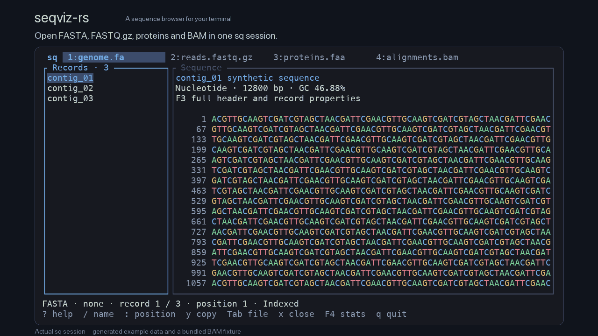

<p align="center">
  
</p>

# seqviz-rs

[English](README.md) | [简体中文](README.zh-CN.md)

**Browse sequences, read quality and variants in your terminal.**

`sq` is a lightweight browser for nucleotide and protein FASTA, FASTQ, SAM/BAM and, new in v0.2.0, VCF. Open plain, gzip or BGZF files, and keep different formats in separate tabs within one window. It runs on macOS and Linux, with an English interface.

```sh
sq genome.fa
sq reads.fastq.gz
sq genome.fa variants.vcf.gz
```

[](assets/demo.gif)

## New in v0.2.0

- **VCF browsing:** a variant table, searchable contig picker, coordinate navigation and INFO, Samples and Raw details.
- **Variant and sample colours:** nucleotide colours for REF/ALT, allele-number colours for GT and matching depth bars for AD. PASS, failed filters and missing values have distinct colours.
- **Contextual copying:** copy the original variant row, an INFO field, a sample with field headings, or the original header with the current record. Drag to select detail text.
- **Mixed file tabs:** switch between sequence and VCF files while retaining each view's position. Existing configurations work unchanged; an optional `[vcf]` section adds display settings.

## Supported files

| File | Main content |
| --- | --- |
| Nucleotide FASTA | Coloured bases, full header, length and GC |
| Protein FASTA | Residue-category colours, full header and length |
| FASTQ | Phred+33 quality colours, aligned quality characters, quality overview and metrics such as Q30 |
| SAM / BAM | Alignment sequence, quality, reference coordinates, FLAG, MAPQ, CIGAR and optional fields |
| Ordinary VCF 4.0–4.5 | Variant table, contig/coordinate navigation, INFO, sample fields, original header and records |

gzip and BGZF are supported for these inputs. FASTQ accepts wrapped sequence and quality fields and parses Illumina, Nanopore, PacBio and SRA headers; original headers are retained.

## Install

### Homebrew

Available for macOS Apple Silicon, Intel and Linux x86_64. The command is `sq`.

```sh
brew install Georicl/tap/seqviz-rs
sq --version
```

To upgrade:

```sh
brew upgrade Georicl/tap/seqviz-rs
```

Theme and yazi examples are under `$(brew --prefix seqviz-rs)/share/seqviz-rs/`, in `config/` and `contrib/`.

### Download a binary

Download from the [latest release](https://github.com/Georicl/seqviz-rs/releases/latest). Rust is not required.

| Platform | Archive |
| --- | --- |
| macOS 11+ · Apple Silicon | [aarch64-apple-darwin](https://github.com/Georicl/seqviz-rs/releases/latest/download/seqviz-rs-aarch64-apple-darwin.tar.gz) |
| macOS 11+ · Intel | [x86_64-apple-darwin](https://github.com/Georicl/seqviz-rs/releases/latest/download/seqviz-rs-x86_64-apple-darwin.tar.gz) |
| Linux · x86_64 | [x86_64-unknown-linux-musl](https://github.com/Georicl/seqviz-rs/releases/latest/download/seqviz-rs-x86_64-unknown-linux-musl.tar.gz) |

Extract the archive, then run these commands in the extracted directory:

```sh
mkdir -p "$HOME/.local/bin"
install -m 755 sq "$HOME/.local/bin/sq"
export PATH="$HOME/.local/bin:$PATH"
sq --version
```

Add `~/.local/bin` to your shell's PATH to use `sq` in new terminals. Archives include theme and yazi examples. Releases also provide [SHA-256 checksums](https://github.com/Georicl/seqviz-rs/releases/latest/download/SHA256SUMS).

### Build from source

Requires Rust stable, Cargo and a C compiler.

```sh
git clone https://github.com/Georicl/seqviz-rs.git
cd seqviz-rs
cargo install --path . --locked
sq --version
```

Or run the bundled examples directly:

```sh
cargo run --release --locked -- test/test.fa test/alignments.bam test/variants.vcf
```

## Controls

| Global action | Key |
| --- | --- |
| Next / previous file | Tab / Shift+Tab, or click a tab |
| Close current file | `x` |
| Help / file information | `?` or F1 / F2 |
| Close information panel / quit browser | `q` |

The mouse wheel scrolls the area under the pointer. For filenames starting with `-`, use `sq -- "-sample.fa"`.

### Sequence browsing

| Action | Key or mouse |
| --- | --- |
| Move through records or sequence | Arrow keys, or `j` / `k` / `h` / `l` |
| Previous / next record | `[` / `]` |
| Focus record list / sequence | Click the area, or Ctrl+h / Ctrl+l |
| Page / beginning / end | Page Up / Page Down / Home / End |
| Search by name / next match | `/`, then Enter / `n` |
| Jump to a sequence position | `:`, then a 1-based coordinate and Enter |
| Select and copy sequence | Drag, or press `v` and move; `y` copies |
| Show / hide quality characters | `Q` |
| Current record / statistics | F3 / F4 |
| Cancel work and pause indexing | Esc in the browsing view |

Sequences wrap to the window width. In FASTA/FASTQ, drag across lines and hold at an edge to keep scrolling; resizing preserves the selected sequence coordinates. F4 shows record count, total length, minimum/maximum/mean length and N50 where applicable. SAM/BAM counts alignment records.

### VCF browsing

The table shows CHROM, POS, ID, REF, ALT, TYPE, QUAL and FILTER. Narrow windows prioritise CHROM, POS, REF and ALT. A record with different ALT variant types is labelled MIXED.

| Action | Key |
| --- | --- |
| Move through variants or detail rows | ↑ / ↓ or `j` / `k`; Page Up / Page Down |
| Focus details / return to table | Enter / Esc |
| INFO / Samples / Raw | `1` / `2` / `3`, or `[` / `]` |
| Scroll details horizontally | ← / →, or `h` / `l` |
| Choose a contig | `c`, type to filter, then Enter; All records is also available |
| Locate a position in the current contig | `:`, then a 1-based coordinate and Enter |
| Original header | `m` or F3 |
| Copy current context | `y` |
| Copy header and current record from table or Raw | `Y` |

Samples retains FORMAT field order and parses visible samples as needed. GT colours identify allele numbers, with the same ordering in AD bars. QUAL and GQ retain their original numeric values; FILTER `.` is distinct from PASS.

## Copying

| Context | Result of `y` |
| --- | --- |
| FASTA record list | Full header and sequence, wrapped at 60 characters |
| FASTQ record list | Full FASTQ record with its original header and separator |
| Sequence selection | Continuous sequence without display wrapping, coordinates or quality rows |
| VCF table / Raw | Current original record, retaining TABs |
| VCF INFO | Current key and value |
| VCF Samples | Current sample with field headings |
| Selected detail text / information panel | Selected text; the entire information panel if nothing is selected |

In the VCF table or Raw, `Y` copies the original header with the current record. Elsewhere in the VCF view, `Y` follows the same context rules as `y`. **All copying is disabled for SAM/BAM, including information panels.**

Local copying prefers `pbcopy` on macOS, or `wl-copy`, `xclip` or `xsel` on Linux. SSH uses OSC 52 and requires terminal support. Copying a complete record reads and buffers the whole record.

## Open from yazi

Merge the matching example into `~/.config/yazi/yazi.toml` and make sure `sq` is on PATH:

| yazi version | Example |
| --- | --- |
| 25.4 | [contrib/yazi.toml](contrib/yazi.toml) |
| 26.9 | [contrib/yazi-26.toml](contrib/yazi-26.toml) |

The opener uses `block = true`. Press Enter on a file to open it, then `q` to return to yazi.

## Large files and configuration

`sq` displays the first screen, then builds the index in chunks. Visible records and content are loaded for the current window; VCF keeps the selected raw record and parses samples as needed. Indexes and decompression checkpoints persist under `$XDG_CACHE_HOME/seqviz-rs/`, defaulting to `~/.cache/seqviz-rs/`. They are reused on later opens and invalidated when the source changes. Ordinary gzip uses checkpoints without making a full uncompressed copy. First access to a distant, unindexed position still requires scanning or decompression.

Source files stay read-only. FASTA supports redirected text output; other formats use an interactive terminal.

The default theme needs no configuration. To customise it, place [config/config.toml](config/config.toml) and [config/content.toml](config/content.toml) in `~/.config/seqviz-rs/`, or in `seqviz-rs/` under an absolute `XDG_CONFIG_HOME`.

`config.toml` sets interface colours and optional `[vcf]` settings for filters, alleles, AD bars and detail height. `content.toml` sets shared nucleotide, amino acid and FASTQ quality colours. Existing configurations need no new fields.

## Contributing

v0.2.0 separates the application shell, shared services, reusable components and format modules into `app`, `core`, `widgets` and `modules`. Each format module owns its reader, data model, view and palette so contributors can work on formats independently.

See the [contribution guide](CONTRIBUTING.md) for code entry points, checks and issue reports.

## Licence

[MIT](LICENSE).
