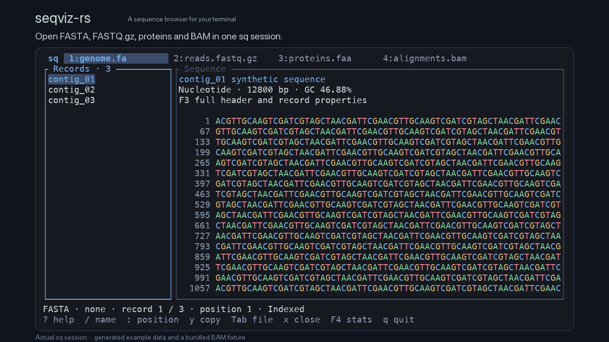

<p align="center">
  
</p>

# seqviz-rs

[English](README.md) | [简体中文](README.zh-CN.md)

**在终端里浏览序列、测序质量和变异，编辑 FASTA 和 FASTQ 记录。**

`sq` 可以在同一窗口的不同标签页打开 FASTA、FASTQ、SAM/BAM 和 VCF，包括 gzip 和 BGZF 压缩文件。支持 macOS 和 Linux，界面为英文。

```sh
sq genome.fa
sq reads.fastq.gz
sq genome.fa variants.vcf.gz
```

[](assets/demo.gif)

## v2.2.1 新增功能

- **比较多个样本的基因型。** 在 VCF 主表按大写 `M`，每行显示一条变异，每列显示一个样本。用方向键选中格子，按 Enter 查看该样本在该位点的 FORMAT 字段。
- **查看每个替代等位基因的频率。** 按数字 `4` 对照文件中的 `INFO/AF` 与从样本基因型计算的频率。按功能键 F4 查看当前筛选范围内的频率分布。
- **编辑 FASTA 和 FASTQ。** 按 `i` 在当前记录中输入、粘贴或替换选区。FASTQ 用 Tab 切换到质量行，为新增或替换的碱基填入质量字符。按 Ctrl+S 保存到原文件。

## 支持的文件

| 文件 | 主要内容 | 模式 |
| --- | --- | --- |
| 核酸 FASTA | 碱基着色、完整 header、长度与 GC | 浏览与编辑 |
| 蛋白质 FASTA | 氨基酸分组着色、完整 header 与长度 | 浏览与编辑 |
| FASTQ | 按 Phred+33 质量着色、质量字符副行、质量概览及 Q30 等指标 | 浏览与编辑 |
| SAM / BAM | 比对记录的序列、质量、参考坐标、FLAG、MAPQ、CIGAR 与附加字段 | 只读 |
| 普通 VCF 4.0–4.5 | 变异表、基因型矩阵、contig/坐标导航、INFO、Samples、Raw、AF 与原始 header | 只读 |

gzip 和 BGZF 适用于上述输入。FASTQ 接受跨行序列与质量字段，解析 Illumina、Nanopore、PacBio 和 SRA header，同时保留原始 header。

## 安装

### Homebrew

支持 Apple Silicon macOS、Intel macOS 和 x86_64 Linux。安装后的命令为 `sq`。

```sh
brew install Georicl/tap/seqviz-rs
sq --version
```

升级到 v2.2.1：

```sh
brew upgrade Georicl/tap/seqviz-rs
```

主题和 yazi 配置示例位于 `$(brew --prefix seqviz-rs)/share/seqviz-rs/` 下的 `config/` 与 `contrib/`。

### 下载二进制

从 [最新 Release](https://github.com/Georicl/seqviz-rs/releases/latest) 下载，无需安装 Rust。

| 平台 | 安装包 |
| --- | --- |
| macOS 11+ · Apple Silicon | [aarch64-apple-darwin](https://github.com/Georicl/seqviz-rs/releases/latest/download/seqviz-rs-aarch64-apple-darwin.tar.gz) |
| macOS 11+ · Intel | [x86_64-apple-darwin](https://github.com/Georicl/seqviz-rs/releases/latest/download/seqviz-rs-x86_64-apple-darwin.tar.gz) |
| Linux · x86_64 | [x86_64-unknown-linux-musl](https://github.com/Georicl/seqviz-rs/releases/latest/download/seqviz-rs-x86_64-unknown-linux-musl.tar.gz) |

解压后，在解压目录执行：

```sh
mkdir -p "$HOME/.local/bin"
install -m 755 sq "$HOME/.local/bin/sq"
export PATH="$HOME/.local/bin:$PATH"
sq --version
```

将 `~/.local/bin` 加入 shell 的 PATH 后，新终端即可使用 `sq`。安装包附带主题与 yazi 配置示例，Release 同时提供 [SHA-256 校验文件](https://github.com/Georicl/seqviz-rs/releases/latest/download/SHA256SUMS)。

### 从源码安装

需要 Rust stable、Cargo 和 C 编译器。

```sh
git clone https://github.com/Georicl/seqviz-rs.git
cd seqviz-rs
cargo install --path . --locked
sq --version
```

也可以直接运行仓库示例：

```sh
cargo run --release --locked -- test/test.fa test/alignments.bam test/variants.vcf
```

## 常用操作

| 全局操作 | 按键 |
| --- | --- |
| 下一个 / 上一个文件 | Tab / Shift+Tab，或点击标签 |
| 关闭当前文件 | `x` |
| 帮助 / 文件信息 | `?` 或 F1 / F2 |
| 退出信息页 / 浏览器 | `q` |

鼠标滚轮滚动指针所在区域。文件名以 `-` 开头时，使用 `sq -- "-sample.fa"`。

### 序列浏览

| 操作 | 按键或鼠标 |
| --- | --- |
| 移动记录或序列光标 | ↑ / ↓ / ← / →，或 `j` / `k` / `h` / `l` |
| 上一条 / 下一条记录 | `[` / `]` |
| 切换记录列表 / 序列焦点 | 点击区域，或 Ctrl+h / Ctrl+l |
| 翻页 / 开头 / 末尾 | Page Up / Page Down / Home / End |
| 按名称搜索 / 下一个匹配 | `/` 输入后按 Enter / `n` |
| 筛选记录 / 切换排序 | `f` 输入条件后按 Enter / `s` |
| 跳到序列坐标 | `:` 输入 1-based 坐标后按 Enter |
| 选择并复制序列 | 鼠标拖选，或按 `v` 后移动光标，再按 `y` 复制 |
| 显示 / 隐藏质量字符副行 | `Q` |
| 编辑当前已索引的 FASTA/FASTQ 记录 | `i` |
| 当前记录 / 统计 | F3 / F4 |
| 取消任务并暂停索引 | 浏览界面中按 Esc |

序列随窗口自动换行。FASTA/FASTQ 可跨行拖选，在边缘停留会继续滚动，缩放后保留选中的序列坐标。F4 显示记录数、总长度、最短/最长/平均长度及适用格式的 N50，SAM/BAM 按比对记录计数。

`f` 使用空格分隔的条件，例如 `name=read minlen=100 maxlen=1000`。支持 `name`、`minlen`、`maxlen`、`mingc`、`maxgc`、`minq`、`maxq`。SAM/BAM 还支持最低 MAPQ 的 `mapq`、必须包含的 FLAG 位 `flag` 和必须排除的位 `noflag`，例如 `mapq=30 noflag=0x104`。GC 使用百分数，质量条件使用每条记录的平均 Phred。多个条件以 AND 同时生效，清空输入后按 Enter 恢复全部记录，按 Esc 放弃修改。

`s` 依次切换源顺序、名称升序、长度降序、GC 降序和平均质量降序，SAM/BAM 另有 MAPQ 降序。缺失值排在最后。名称搜索遵守当前筛选与排序，选中记录在索引继续增长时保持不变。

序列 F4 统计覆盖全文件已完成索引的记录，包括长度、GC、记录平均质量的区间分布、按质量字符数加权的平均 Phred 与 Q30，以及 SAM/BAM 的 mapped、unmapped、primary、secondary、supplementary 和 duplicate 计数。筛选列表不改变全文件统计范围，索引尚未完成时会在状态中标明。

### 编辑 FASTA / FASTQ

| 操作 | 按键 |
| --- | --- |
| 编辑当前已索引记录（含选区） | `i` |
| 移动光标 / 扩展选区 | 方向键 / Shift+方向键 |
| 粘贴序列或质量文本 | 终端粘贴快捷键（macOS 通常为 ⌘V） |
| 删除碱基（及对应 FASTQ 质量） | Backspace / Delete |
| 切换序列行与 FASTQ 质量行 | `Tab` |
| 写回原文件并刷新索引 | `Ctrl+S` |
| 返回浏览 / 放弃未保存草稿 | `Esc` / 连按两次 `Esc` |

移动到已索引 FASTA 或 FASTQ 记录的目标位置，或先选中一段序列，再按 `i` 打开编辑器。可直接输入，也可使用终端粘贴快捷键。粘贴多行序列时会忽略空白字符，并替换当前选区。

FASTQ 中第二行显示可打印的 Phred+33 质量字符。删除碱基会同步移除对应质量值。新插入或替换的碱基下方会显示 `·`，表示该位置的质量字符待填。按 `Tab` 跳到质量行中第一个待填位置，输入或粘贴可打印 Phred+33 质量字符，再按 `Tab` 回到序列行。

按 `Ctrl+S` 将修改写回原文件并刷新索引。普通文本、gzip 和 BGZF 均保留原有压缩类型。如果源文件在载入后被外部修改，保存会被阻止以避免覆盖。按 `Esc` 返回浏览，有未保存修改时连按两次 `Esc` 放弃草稿。VCF 和 SAM/BAM 保持只读。

### VCF 浏览

主表显示 CHROM、POS、ID、REF、ALT、TYPE、QUAL、FILTER，窄窗口优先保留 CHROM、POS、REF、ALT。多 ALT 包含不同变异类型时显示 MIXED。

| 操作 | 按键 |
| --- | --- |
| 移动变异或详情行 | ↑ / ↓ 或 `j` / `k`，Page Up / Page Down |
| 聚焦详情或查看矩阵格子 / 返回 | Enter / Esc |
| 切换变异表 / 基因型矩阵 | `M` |
| INFO / Samples / Raw / AF | `1` / `2` / `3` / `4`，或 `[` / `]` |
| 切换 GT 频率的计算范围（全部 / 固定样本） | AF 详情或 F4 统计中按 `a` |
| 横向滚动详情 | ← / →，或 `h` / `l` |
| 选择 contig | `c`，输入名称筛选后按 Enter（也可选择 All records） |
| 在当前 contig 定位 | `:` 输入 1-based 坐标后按 Enter |
| 筛选变异 / 切换排序 | `f` 输入条件后按 Enter / `s` |
| 当前筛选结果统计 / 刷新统计 | F4 |
| 按样本名定位 / 下一个匹配 | `/` 输入后按 Enter / `n` |
| 固定当前样本 / 切换仅显示固定样本 | Samples 或矩阵中按 `p` / `P` |
| 选择 FORMAT 字段 | `F`，例如输入 `GT,DP,AD` |
| 原始 header | `m` 或 F3 |
| 按当前上下文复制 | `y` |
| 在主表或 Raw 中复制 header 与当前记录 | `Y` |

在 VCF 标签页按大写 `M` 切换基因型矩阵。每行对应一条变异记录，每列对应一个样本。使用方向键选择单元格，按 Enter 查看该单元格的 FORMAT 值，按 Esc 返回原格。源文件中的 GT 与相位信息保持原样，含缺失等位基因的 GT 保留点号，`—` 表示该记录没有 GT 字段。矩阵沿用当前的筛选、排序与固定样本显示设置。

按数字 `4` 查看每个 ALT 的两种频率。第一列频率来自文件的 `INFO/AF`。另一列由样本的 GT 计算，`AC` 是该 ALT 出现的份数，`AN` 是所有已知等位基因的份数，`AF = AC / AN`。部分缺失的 GT 仍计入已知的等位基因。AN 为零时频率显示为 `.`。默认使用全部样本，按小写 `a` 可切换为只用固定样本计算。

Samples 默认保留 FORMAT 字段顺序，并按需解析可见样本。用 `F` 选择并重排字段，清空输入恢复全部字段。该选择在切换变异后保持有效，当前变异缺少的字段显示 `.`。固定样本名称带下划线，`P` 在固定样本与全部样本显示间切换。复制内容的字段标题与当前显示顺序一致。REF/ALT 使用碱基色，GT 颜色表示等位基因编号且 AD 深度条顺序一致，QUAL 与 GQ 保留原始数值，FILTER `.` 与 PASS 区分显示。

VCF 筛选条件以空格分隔，例如 `pass qual>=30 type=SNV` 或 `contig=chr1 start=100 end=200 sort=-qual`。支持 `pass`、`qual>=`、`qual<=`、`type=`、`id=`、`contig=`、`start=` 和 `end=`。位置范围含两端，`id` 为区分大小写的字面子串匹配。可用 `sort=source|pos|qual|type` 指定排序（前加 `-` 为降序），或按 `s` 循环切换排序。contig 选择器与输入条件同时生效，清空筛选输入恢复默认条件与源顺序。

F4 汇总当前 contig 和筛选条件内已建索引的记录，显示变异类型、FILTER 状态、QUAL 分布、基因型完整性和 ALT 频率分布。频率分布按 ALT 个数计数，多等位位点可贡献多个 ALT。`a` 只改变从 GT 计算 AF 时使用的样本，基因型完整性计数始终覆盖全部样本。索引仍在建立时，再按 F4 可以刷新。

## 复制内容

| 位置 | `y` 的结果 |
| --- | --- |
| FASTA 记录列表 | 完整 header 和完整序列，每行 60 字符 |
| FASTQ 记录列表 | 完整 FASTQ 记录，保留原始 header 与分隔行 |
| 序列选区 | 连续序列，不带显示换行、坐标或质量副行 |
| VCF 主表 / Raw | 当前原始记录行，保留 TAB |
| VCF INFO | 当前键值 |
| VCF AF | 当前 ALT 的频率统计行 |
| VCF Samples | 当前样本及字段标题 |
| 详情文字选区 / 信息页 | 所选文字，信息页无选区时复制整页 |

VCF 主表或 Raw 中的 `Y` 复制原始 header 与当前记录，VCF 其他位置中 `Y` 沿用 `y` 的上下文规则。详情区域支持拖选文字。**SAM/BAM 禁用全部复制功能，包括信息页。**

本地优先使用 `pbcopy`（macOS）或 `wl-copy`、`xclip`、`xsel`（Linux）。SSH 使用 OSC 52，需要终端支持。复制完整记录时会读取并暂存整条记录。

## 从 yazi 打开

将对应配置合并到 `~/.config/yazi/yazi.toml`，并确保 `sq` 在 PATH 中：

| yazi 版本 | 配置示例 |
| --- | --- |
| 25.4 | [contrib/yazi.toml](contrib/yazi.toml) |
| 26.9 | [contrib/yazi-26.toml](contrib/yazi-26.toml) |

opener 使用 `block = true`。选中文件按 Enter 打开，按 `q` 退出后返回 yazi。

## 大文件与配置

`sq` 先显示首屏，再分块建立索引。可见记录与内容按窗口读取，VCF 只保留当前选中的原始记录并按需解析样本。索引与解压检查点保存在 `$XDG_CACHE_HOME/seqviz-rs/`，默认 `~/.cache/seqviz-rs/`，再次打开可复用，源文件变化会使旧索引失效。普通 gzip 使用解压检查点，不生成完整解压副本。首次访问尚未索引的远处位置仍需扫描或解压。

浏览不会修改源文件。编辑 FASTA/FASTQ 仅在按 `Ctrl+S` 时写回，若源文件已在磁盘上变化则阻止覆盖。FASTA 支持重定向输出文本，其他格式使用交互终端。

默认主题开箱可用。将 [config/config.toml](config/config.toml) 与 [config/content.toml](config/content.toml) 放到 `~/.config/seqviz-rs/`，使用绝对路径的 `XDG_CONFIG_HOME` 时放到其下的 `seqviz-rs/` 目录。

`config.toml` 配置界面颜色及可选的 `[vcf]` 设置（过滤状态、等位基因颜色、AD 条和详情高度）。`content.toml` 配置共享碱基、氨基酸和 FASTQ 质量颜色。旧配置无需新增字段即可继续使用。

## 参与开发

代码库将应用外壳、公共服务、通用组件和格式模块分别组织在 `app`、`core`、`widgets` 和 `modules` 中。各格式模块维护自己的读取、数据模型、视图和配色，便于独立开发。

开发入口、检查命令及问题反馈方式见 [贡献指南](CONTRIBUTING.md)。

## 许可协议

[MIT](LICENSE)。
